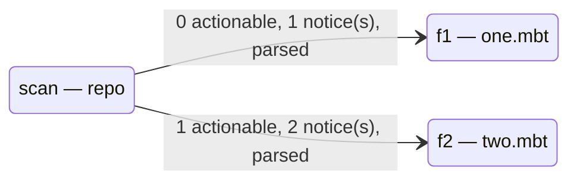

# A document with a diagram

This page exercises the Mermaid side of the Markdown pipeline: the code
block below is turned into a drawing by the browser, using the runtime that
is inlined into the page.

## And some text

| file | actionable | notices |
| --- | --- | --- |
| f1 | 0 | 1 |
| f2 | 1 | 2 |

- a list item
- another one
- [x] a task item
